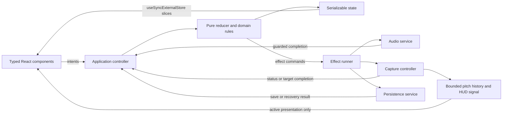

> Historical planning document. The standalone prototype and design preview have been retired.
> See the [current README](../../README.md) and [architecture](../architecture.md) for the maintained app.

# Pitch Perfect Studio technical design

**Revision:** 1.1, 2026-11-03.\

**Implementation checkpoint (2026-11-03):** The requested React application is now
implemented in `studio/` and runnable separately with `npm run dev`. All five
modes, shared Setup, synthesis/capture, scoring and validated progress migration
are connected. See [README](../../README.md) for commands and release boundaries.
The actual typed controller uses immutable external-store snapshots and pure
domain functions; a general action/effect-reducer framework and the illustrative
file tree below were not introduced. Actual storage interfaces live in
`studio/src/domain/types.ts` and `studio/src/persistence.ts`; guided-session and
onboarding fields remain deferred. This checkpoint does not turn proposed UAT
into completed device validation. The legacy main entry remains available.

User-selected policy updates supersede the earlier recommendations below:
Harmony defaults to tonic and offers explicit Scale roots; ambiguous chord
practice shows/auditions its root; seventh chords expose all four inversions;
unavoidable repeated targets require Ready Again. Mobile/desktop visual drafts
were generated in Superdesign; real-device microphone, audio, accessibility and
performance acceptance remains outstanding.

**Status:** Proposed technical design before implementation.\
**Product inputs:** [Current product specification](product-spec.md) and
[UI/UX improvement plan](ux-improvement-plan.md).\
**Scope:** Translate the five-mode product and `UX-01`–`UX-14` into an implementable
frontend design, preserving the baseline capabilities and tracking the existing
`PPS-*` tickets and `U-*` acceptance scenarios.

**Agreed target stack:** React, strict TypeScript, Vite, Tailwind CSS, shadcn/ui,
and Motion. This supersedes revision 1.0's conservative vanilla-only proposal.
The current prototype remains unchanged; implementation has not started.

Migrate incrementally to typed React composition while preserving pure musical
rules and explicit non-React owners for audio, microphone, timers, and grading.
Use one application state and one responsive component tree. A synthetic test
still does not prove microphone quality or mobile support.

The [design system](design-system.md) defines visual tokens and component states;
the `interactive design preview` (retired prototype) makes desktop/mobile flows
reviewable. The standalone preview may use HTML/CSS and is not a production
React implementation. These artifacts and this revision support the requested
PM review before implementation; proposed behavior and unresolved product
policies are not silently treated as stakeholder-approved decisions.

## TD-01 Existing system and design decisions

### Current implementation evidence

| Current fact | Evidence | Design consequence |
| --- | --- | --- |
| Current prototype has native ES modules, no runtime dependencies or build step | [package.json](../../package.json), `index.html` (retired prototype) | Migrate deliberately to the user-selected React/TypeScript/Vite stack without mixing old and new resource owners. |
| State, DOM mutation, synthesis, generation, grading, and capture share one IIFE | `app.js` (retired prototype), particularly state at line 70 and `refreshAllModules` at line 536 | Extract by responsibility and route user intents through one controller. |
| Timers and oscillators have no shared cancellation owner | `playNote`, `startNewNoteQuestion`, `playSATBProgression` in `app.js` (retired prototype) | Every effect needs an owner and an invalidation token. |
| Capture acquisition is asynchronous, while Stop and navigation are synchronous | `toggleMicrophone` and `stopMicrophone` in `app.js` (retired prototype) | Late results must clean up their own resources without changing a newer request. |
| Pitch detection and broad DOM/canvas work share an always-running frame loop | `updatePitchLoop` and `drawPitchCanvas` in `app.js` (retired prototype) | Separate analysis, eligibility, presentation, and display scheduling. |
| Persistence stores aggregate legacy counters without settings or strict validation | `saveStats` and startup load in `app.js` (retired prototype) | Introduce a validated versioned envelope without inventing historical breakdowns. |
| Existing tests exercise pure rules and source functions through a minimal-DOM VM | `practice.test.js` (retired prototype), `app-regressions.test.js` (retired prototype) | Retain their behavioral expectations, then replace source-text extraction with normal module imports as code moves. |

The preceding audit recorded 13 passing Node regressions and syntax checks.
They are prototype evidence, not results for the unimplemented React application.
Visual-preview review is a separate activity; it does not establish production
device, microphone, accessibility, or performance acceptance.

### Technical choices and alternatives

| Choice | Recommendation and tradeoff |
| --- | --- |
| Frontend stack | React + strict TypeScript + Vite is the agreed target. React owns component composition; TypeScript checks contracts; Vite supplies development/build tooling. Keep domain/audio/storage modules framework-independent so migration does not entangle musical correctness with rendering. |
| State coordination | A small pure reducer plus an effect runner; ordinary functions rather than a state-machine framework or global event bus. This makes lifecycle rules explicit while limiting abstraction. |
| View composition | Typed React components, selector-scoped external-store subscriptions, shadcn/ui primitives, and custom music widgets. Keep stable component identity and one modal Setup instance across breakpoints. |
| Style and motion | Tailwind utilities consume semantic CSS variables from the design system. Own generated shadcn component source in the repository; use one Radix-backed preset consistently. Motion handles purposeful React transitions with reduced-motion support, not grading clocks or audio sequencing. |
| Real-time work | Keep the detector behind an interface on the main thread initially, reuse buffers, and measure. A Worker or AudioWorklet is a later profiling-driven alternative, not a prerequisite or promised optimization. |
| Persistence | A new `pitch_perfect_studio_v2` envelope with a one-time validated legacy snapshot; preserve the existing `pitch_perfect_studio_v1` key. No dual-writing of scoring counters. A user-confirmed full-progress reset is the explicit legacy-zeroing exception described in TD-09. |
| Routing | In-page mode state and semantic mode controls. Deep-link/history routing is outside the present requirements and need not introduce a router. |
| Mobile delivery | Responsive browser-first app. A future PWA may add installation/offline-shell behavior after device and update-policy design; no service worker, manifest, native wrapper, or background-audio guarantee is part of this implementation scope. |

### Product decisions carried into the design

These are recommended working choices. Update the product spec when a choice
is adopted or changed; unresolved policy does not block unrelated architecture.

| Product decision | Recommended working choice | Resolution needed before the affected feature ships |
| --- | --- | --- |
| D-01 range and scale | Hard-limit learner note/interval/sung targets; label accompaniment exceptions. Generate valid candidates rather than clamp an arbitrary root. Harmony defaults to the selected tonic in a feasible octave. | Confirm the tonic policy and the renamed New Root behavior described in TD-04; keep any permitted local override explicit in the product spec. |
| D-02 ambiguous chords | In every random-voicing quality exercise and every inversion-graded exercise, display the reference root and offer Hear Root before answering. Retain all qualities with that context instead of silently choosing one interpretation of an ambiguous voicing. | Product acceptance of root-context training; fixture coverage includes cross-quality aliases as well as symmetric chords. |
| D-03 seventh inversions | Generate `0…numberOfTones−1`, so seventh chords offer all four inversions and triads three. | This extends the current subset; agree the scope and labels before PPS-02 acceptance. |
| D-04 legacy progress | Preserve exact valid legacy aggregates, collect new mode-specific counters prospectively, and never allocate old aggregate accuracy to modes. | Adopt the TD-09 schema, reset semantics, and rollback limitations. |
| D-05 repeated targets | Unique target instances; avoid consecutive equal targets when possible. For an unavoidable repeated pitch, require a release/out-of-tolerance interval or explicit Ready Again before another hold can begin. | Validate rearming with singers and accessibility needs; the suggested release interval is a tunable working value, not a measured fact. |
| D-06 support | Use the product matrix; record exact release devices/browser versions and actual evidence. | Name and execute real combinations. No browser support claim follows from this design. |
| D-07 personality | Warm ink/olive surfaces, paper text, lime/lilac accents, editorial display type, and literal controls, specified in the companion design system. | Review the concrete preview and visual states with PM and learners; keep the approved stack separate from still-proposed product policy. |

## TD-02 Architecture and module contracts



Proposed target layout; these files do not yet exist:

```text
src/
  main.tsx                    create runtime/root once; StrictMode; HMR teardown
  app/App.tsx                 shared shell and provider composition
  app/runtime.ts              inert services, controller wiring, attach/dispose
  app/store.ts                typed immutable reducer, slice snapshots, subscriptions
  app/controller.ts           intents and ordered side effects
  app/RuntimeProvider.tsx     stable runtime reference, not a full-state context
  app/useAppSlice.ts          typed useSyncExternalStore adapter
  domain/types.ts             discriminated questions, answers, outcomes, settings
  domain/music.ts             vocabulary, conversion, naming, range validation
  domain/exercises.ts         note/interval/chord/harmony/drill generation
  domain/grading.ts           answer evaluation, hold rules, scoring outcomes
  domain/progress.ts          counters and session summaries
  audio/engine.ts              context, timbres, master bus, voice handles
  audio/scheduler.ts           owned playback and cancellation
  audio/capture.ts             request/track/graph/interrupt lifecycle
  audio/pitch.ts               detector and reusable buffers
  persistence/schema.ts       unknown-data validation and normalized envelope
  persistence/storage.ts      migration, commit, reset, recovery
  components/ui/              selected owned shadcn primitive source
  ui/shell/AppShell.tsx        navigation, shared audio state, panels
  ui/setup/SetupDialog.tsx     one responsive Dialog and draft transaction
  ui/practice/QuizStage.tsx    shared feedback/actions and exact-note inputs
  ui/modes/                   Notes/Intervals/Chords/Harmony/Tuner components
  ui/piano/PianoKeyboard.tsx   custom octave-focused audition/answer input
  ui/pitch/PitchDisplay.tsx    scoped HUD, canvas ref, text summary
  ui/progress/ProgressPanel.tsx legacy/new metrics, reset, review
  styles/globals.css          Tailwind entry and semantic variable mappings
  styles/tokens.css           design-system values and motion/type/spacing tokens
vite.config.ts                React and Tailwind plugins; future test integration
tsconfig*.json                strict app/tool/test checking
components.json               chosen shadcn preset, aliases, CSS variable path
```

Preserve the existing prototype as comparison evidence during migration. Port
its behavioral tests to direct typed imports instead of introducing TypeScript
imports into the Python-served entrypoint. The Vite/React entrypoint replaces
the old IIFE at cutover; they never both own live handlers or streams. Avoid a
plugin framework or generic component factory; split files at real ownership
boundaries rather than to satisfy the illustrative tree.

The following are proposed **TypeScript contracts**, checked by the target
toolchain. Use `strict:true`, discriminated unions, explicit nullable states,
and `unknown` at JSON/browser boundaries; do not cast unvalidated storage data
to a trusted type. Runtime validation remains necessary despite static types.
[TypeScript: strict](https://www.typescriptlang.org/tsconfig/strict.html)

```ts
type Mode = 'notes' | 'intervals' | 'chords' | 'harmony' | 'tuner';
type QuizMode = 'notes' | 'intervals' | 'chords';
type GenerationResult<T> =
  | { ok: true; value: T }
  | { ok: false; code: string; fields: string[]; remedies: string[] };
type Owner = { modeEpoch: number; scopeId: string; effectId: string };
type QuizRound = {
  id: string; configRevision: number; mode: QuizMode;
  phase: 'ready'|'playing'|'awaitingAnswer'|'retry'|'correct'|'skipped';
  question: Question; answer: AnswerDraft; attempts: number;
  credited: boolean; lastSubmissionId: string|null;
};
type PitchSample = {
  captureEpoch: number; modeEpoch: number; targetId: string|null;
  observedAtMs: number; frequencyHz: number|null;
  inputKind: 'live'|'preview'; usable: boolean;
};
// Runtime resources never appear in persisted or reducer state.
type VoiceHandle = { owner: Owner; started: boolean; cancel(): void };
type CaptureLease = { epoch: number; dispose(): void };
type ControllerDependencies = { random(): number; nextId(): string; nowMs(): number };
```

State contains plain data: committed configuration and revision; draft settings
or null; active mode and mode epoch; per-mode round/target descriptors; capture
and playback status; progress; optional current session; persistence status.
Sets become validated arrays at the persistence boundary. Derive labels,
percentages, enabled answers, and active-range summaries rather than storing
duplicate representations.

Resources stay in services: AudioContext, nodes, streams, tracks, timer IDs,
AbortControllers for listeners, observers, rAF handles, analyser workspaces, and
the bounded pitch ring buffer. Controllers own their subscriptions and dispose
them once. High-frequency pitch samples do not trigger a complete application
render; only relevant pitch views subscribe to the presentation signal.

### React integration and resource ownership

Create an **inert** runtime once in the browser bootstrap, outside React render,
then pass its stable reference through `RuntimeProvider`. Inert construction may
allocate plain stores/controllers, but never creates an AudioContext, requests
media, starts timers, or imports browser-only globals in domain modules. Explicit
event handlers call controller commands; no Effect is used to infer “start mic”
from a rendered boolean. The bootstrap owns runtime attach/dispose and the React
root; hot replacement disposes the previous runtime/root before creating another.

Keep StrictMode enabled. React's development render/effect/ref checks must not
create a second context, request permission, write migration twice, or score an
outcome. Component Effects own only their subscription/observer/local animation
cleanup. Provider effect cleanup must not destroy a bootstrap-owned singleton
and then reuse that disposed object during the development setup cycle. Runtime
disposal, listener unsubscribe, and lease cancellation are idempotent; test root
unmount/remount and HMR in addition to ordinary navigation.
[React: StrictMode](https://react.dev/reference/react/StrictMode)

Use `useSyncExternalStore` through typed slice sources whose `subscribe` and
`getSnapshot` functions are stable. An unchanged slice returns the same immutable
snapshot; a reducer commit structurally shares unaffected slices. Preconstruct
mode/shell/progress sources in the runtime, and memoize composite projections
rather than returning a fresh object on every snapshot read. Context carries the
runtime reference only; it does not broadcast the complete state or pitch stream.
[React: useSyncExternalStore](https://react.dev/reference/react/useSyncExternalStore)

```tsx
function QuizPanel({ mode }: { mode: QuizMode }) {
  const runtime = useRuntime();
  const source = runtime.store.practiceSource(mode); // Stable, cached source.
  const round = useSyncExternalStore(source.subscribe, source.getSnapshot);
  return <QuizStage round={round} onPlay={() => runtime.commands.play(mode)} />;
}
```

Low-frequency structural changes go through the reducer. Pitch text subscribes
only to a throttled HUD slice; a canvas ref and optional Motion values consume
the active presentation signal without rendering App on every sample. Pure
React rendering never mutates musical state or starts/stops a service. An app
error boundary stops owned resources from its error/commit callback, not while
rendering the fallback; async service errors still use their
explicit guarded error path rather than relying on a render ErrorBoundary.

## TD-03 Exercise lifecycle, event ordering, and idempotency

All intents pass through `dispatch`. The reducer computes the new state and
effect commands synchronously; state is committed before commands run. Async
services return events rather than mutating state or React-managed DOM. Audio/permission
startup happens from the intentional event path, with failures returned visibly.

Only the controller/effect boundary reads randomness, generates IDs, or reads a
clock. It passes the resulting plain values and prepared domain results in an
action. Candidate enumeration, grading, and reducer execution depend only on
their explicit data inputs; replaying the same state/action sequence is
deterministic. The `ControllerDependencies` interface is injected for tests and
must not be called from the reducer under a claim of purity.

| Intent/event | State rule | Effects and stale-work guard |
| --- | --- | --- |
| Play / Replay | Generate only if no valid prepared question; otherwise reuse its identity. An unresolved round enters Playing. A Correct/credited round stays Correct during review playback and cancels auto-next. | Replace the same round's playback owner; guard started/finished events by mode epoch, round ID, and config revision. Review playback never reopens grading. |
| Playback finished | Enter Awaiting Answer only for the current unresolved eligible round. A completed round remains Correct/credited. | Enable unresolved answer submission; never create a different question or permit post-success wrong-attempt counting. |
| Submit answer | Accept only in Awaiting Answer/Retry, with complete valid input. Wrong counts an attempt and enters Retry; correct counts once, sets `credited`, enters Correct. | Emit one progress outcome; duplicate submission IDs or closed rounds are no-ops. Missing octave/inversion explains the missing input without scoring. |
| Next / Skip | Cancel outgoing owners, mark a skip without XP, create one new round ID and clear selections. | User-initiated Next may start that question's playback; it is never a second scheduled continuation. |
| Auto-next elapsed | Accept only for the same Correct round, active mode, matching epoch/revision, enabled auto-next, visible document, no overlay/pause. | Otherwise discard. A scheduled callback never reads whatever question happens to be current. |
| Mode changed | Increment mode epoch; cancel outgoing output and continuation; reset hold. Preserve setup. | Retain capture only Harmony↔Tuner with visible status. Entering a quiz stops capture. No hidden mode starts work. |
| Stop All / page hidden | Invalidate relevant epochs, reset holds, mark stopped/interrupted; preserve question/config/progress. | Cancel all owned audio/timers and capture. Return to explicit Play/Start; no automatic audio restart on visibility return. |

Keep per-mode question identity while navigating so returning users can replay
the unresolved question; completed rounds remain credited. A behavior-changing
global configuration invalidates affected cached questions, including hidden
modes. A returning mode with invalidated data shows Ready rather than silently
using an old answer pool.

Playback variants are parameters to the same command from the first action:
`playInterval(round, 'harmonic')`, `playInterval(round, 'melodic-desc')`, or
`playChord(round, 'arpeggio')`. Do not create a question via a separate default
playback path first. Chord quality and inversion use explicit selections plus
Check Answer; no hidden root-position default submits. A new round clears both.

Transient `submissionId`/`roundId` guards prevent duplicate callbacks in one
running app; they are not a server-backed anti-cheat or cross-tab transaction.
Maintain one application bootstrap and one subscription set. During migration,
an old handler and a new controller must never both own the same control.

## TD-04 Settings transaction and musical validity

Opening Setup clones committed settings into a typed draft; controlled React
fields dispatch draft edits. Keep editable numeric text separate from validated
committed numbers so an incomplete input can show an error without coercion.
Validation returns field-level errors and whole-exercise incompatibilities.
Apply cannot commit an invalid configuration. Corrected/clamped values are shown
in the field, and manual endpoints select Custom instead of leaving a stale
preset label.

| Change | Round/queue impact on Apply | Audio/capture impact |
| --- | --- | --- |
| Notation and purely explanatory display preferences | Reformat without changing identity, selections, queue position, or earned counters. | Preserve actual resource state; never restart audio. |
| Timbre | Preserve targets; apply to future one-shot playback. | Do not mutate a sounding voice or restart a drone merely to change a label. |
| Auto-advance | Preserve round; disabling cancels its continuation. Enabling after a completed round does not create an unexpected timer. | No automatic playback. |
| Range, key, scale, tuning, exercise filters/modes, exact-octave or grading tolerance | Invalidate affected question/target and prepare a valid replacement in Ready; clear incompatible selections and reset hold. | Stop affected output and active capture; require explicit Play/Start. Explain this consequence before Apply. |
| Master volume/mute | Immediate shared controls, not a hidden Setup draft side effect. | Change output bus only; never imply microphone Stop. |

Opening the dialog suspends grading and cancels continuation without deleting
the round. Active capture/backing may continue only with status and Stop All
also inside the dialog; modal background controls are not reachable. Reset the
live hold because the task is interrupted. A one-shot already playing may finish
and update its real playback status. Cancel discards only configuration edits:
it does not rewind time, restore a cancelled auto-next, undo Stop All, reopen a
stopped stream, or replay an interrupted sound. Notation-only Apply preserves
the resource state that actually remains, not a resource snapshot.

Candidate enumeration is pure; the controller supplies a selection value and
new identity as plain input. There is no fallback C4 and no repeated random retry
loop without a bound. The recommended initial accompaniment/synthesized register
is C2–C6, MIDI 36–84 inclusive, independent of the narrower learner range.
Chord roots come from scale-member candidates in this backing register and are
retained only if their complete inverted voicing fits it; the summary labels
both learner and accompaniment ranges. Extending that register requires a
deliberate scope/content change rather than accidental out-of-range notes.

| Exercise | Candidate rule |
| --- | --- |
| Note | All MIDI pitches in inclusive configured range whose pitch classes belong to the selected scale. |
| Interval | Define the lower pitch as the interval's reference anchor; enumerate pairs `(anchor, anchor + distance)` with both notes in range and anchor in the selected scale. Fixed-root restricts this lower anchor to tonic octaves. Descending plays the upper pitch first and labels the lower tonic as the anchor, not the first-sounded note. Direction changes playback order, not validity. If any selected interval has no pair, report it rather than silently remove it from training. |
| Chord | Use selected quality and scale-member roots in the declared backing register; build inversion from its tone count. Accompaniment may exceed the learner's sung range, clearly labeled. Check resulting pitches remain inside the supported synthesized register. |
| Harmony | Default to a feasible tonic octave with the chosen target interval inside the learner range. Backing uses the declared accompaniment register. If no target fits, return an incompatibility and useful range/challenge remedies. |
| Scale walk | Build a labeled tonic-to-tonic ascending form and descending return that fits. Use all defined scale steps, not the first eight arbitrary pool entries. The melodic-minor descending form remains the currently defined form until a product/content change explicitly chooses otherwise. |
| Arpeggio | Enumerate tonic roots whose full promised `1–3–5–8–5–3–1` pattern fits the target range. Minor/major choice comes from explicit exercise configuration or an explained scale mapping; do not infer every mode from whether its ID contains `minor`. |

The proposed tonic-only Harmony policy changes what the current New Root action
means. Recommended initial behavior is **Change reference octave**, selecting
another feasible tonic octave; when only one exists, explain that instead of
pretending to generate a different root. If arbitrary scale-root practice is
retained, add an explicit local-root policy and amend UX-09.B before implementing
it. This is D-01, not an unnoticed deletion of baseline functionality.

Additional design-audit finding supplied by actual-source execution:
`buildChordMidiNotes(60,[0,2,7],1)` and
`buildChordMidiNotes(55,[0,5,7],2)` both produce `[62,67,72]`—C sus2 in first
inversion and G sus4 in second inversion. This extends G-23 beyond symmetric
inversion labels: random-voicing **quality** can also be ambiguous. Displaying
and optionally auditioning the intended reference root for all such exercises
resolves the declared interpretation without treating a listener as wrong for
an equivalent unlabeled voicing. Fixtures must retain this pair and the baseline
augmented pair; excluding augmented chords alone is insufficient.

All 11 qualities, 12 supported non-unison intervals, 10 scales, 9 range presets,
8 harmony challenges, 4 progressions, and 4 SATB lanes remain in the inventory.
Store progression content as named step data with explicit pitches/intervals
and labels; test actual pitch-class sets against each promised quality. Correct
the Jazz/Barbershop mismatch before claiming reviewed content. Mixer view derives
initial displayed notes and Audition Voice from the same first-step data.

## TD-05 Audio ownership and cancellation

`AudioEngine` lazily creates one context, a master GainNode, and per-owner gains.
All synthesized voices, backing, references, isolated voices, and progressions
connect through this master bus. Microphone analysis never connects to speakers.
Retain the existing timbre recipes behind `createVoice`; keep the sustained
backing timbre explicit rather than implying it follows Instrument.

An owner contains the mode epoch, logical scope, and effect ID. The scheduler
registers every oscillator/node handle, gain envelope, visual callback, and
completion timer. Cancelling a scope invalidates its token **before** clearing
handles, so a callback already queued becomes harmless. Different child scopes
allow Harmony backing plus a target cue, while a mode-level cancellation reaches
both. Replay replaces that round's prior playback; progression Play replaces its
prior run rather than layering another run.

Schedule short musical sequences on `AudioContext.currentTime`. For progression
steps, use a small look-ahead scheduler with owned timers and an audio-clock
playhead; mute flags affect unscheduled steps and can silence the lane's current
gain. UI timeouts are presentation aids, not the source of musical timing.
Every already-scheduled source must still be cancellable; clearing a JavaScript
timer alone does not cancel Web Audio starts.

On cancellation, immediately invalidate completion/highlight callbacks, cancel
gain automation, apply a short click-avoiding release, and call `stop` on started
or scheduled source nodes. Track whether `start()` was invoked: calling stop on
a never-started source is invalid. A scheduled source stopped before its start
will not sound; a later stop call can replace a previous future stop time.
[MDN: AudioScheduledSourceNode.stop](https://developer.mozilla.org/en-US/docs/Web/API/AudioScheduledSourceNode/stop)

Node `ended` cleanup disconnects owned graphs and removes handles. Cancellation
also disconnects never-started/failed graphs and removes listeners. Ignore only
known already-disposed cleanup conditions; unexpected errors become service
diagnostics and a truthful output state rather than a blanket empty catch.
Cancellation also removes the owner's registry entries through idempotent
disposal when the context is suspended/closed or an `ended` callback cannot
arrive promptly; cleanup must not depend exclusively on continued audio time.

`ensureRunning()` requests creation/resume from the direct intentional action,
awaits successful running state, and checks owner validity again before any
source starts. Resume failure returns a visible Retry state. Stop All invalidates
pending resume commands as well as scheduled playback; a late resume cannot
schedule notes. Keep a stopped context reusable during the page lifetime rather
than close/recreate it on every action. Page disposal cancels everything; a
restored page resumes only after an explicit action.

Reference/cue/full-blend/preview owners publish their audible exclusion interval
to grading, including scheduled duration and release. Reset hold on exclusion
start; do not credit samples spanning that interval. Cancellation ends the
exclusion only after its actual release and analyser-buffer settling period.
The settling value is a measured/configured engineering parameter, not proof
that all acoustic echoes are gone. Continuous non-target backing in Harmony is
permitted accompaniment; speaker bleed remains a real-device risk and headphones
are recommended. Simulated samples are tagged preview and never eligible.

## TD-06 Microphone requests, interruption, and cleanup

Capture status is distinct from output status: Off, Preparing, Awaiting Permission,
Listening, Silent/Unusable, Denied, Unavailable, Interrupted, Stopped. The service
owns one accepted lease; each request owns its own local candidate stream and
graph. A monotonically increasing request epoch is the authority to adopt it.

```ts
async function startCapture() {
  const epoch = ++requestEpoch;
  disposeAcceptedLease();
  setCurrentStatus(epoch, 'preparing');
  let candidate = null;
  let graph = null;
  let localLease = null;
  try {
    // Creation/resume is initiated directly by Start, before any async wait.
    const contextReady = audioEngine.ensureRunningFromGesture();
    const context = await contextReady;
    if (!isCurrentAndWanted(epoch)) return;
    setCurrentStatus(epoch, 'awaitingPermission');
    candidate = await mediaDevices.getUserMedia(captureConstraints);
    if (!isCurrentAndWanted(epoch)) return stopTracks(candidate);
    graph = await createAnalysisGraph(context, candidate);
    if (!isCurrentAndWanted(epoch)) return disposeCandidate(candidate, graph);
    localLease = makeLocalLease(epoch, candidate, graph);
    candidate = null; graph = null; // Local lease now owns these resources.
    attachGuardedTrackListeners(localLease);
    if (!isCurrentAndWanted(epoch)) return;
    if (!localLease.isLive()) {
      setCurrentStatus(epoch, 'interrupted');
      return;
    }
    acceptedLease = localLease; // Publish only after complete local construction.
    localLease = null;         // Ownership transferred; no awaited work here.
    setCurrentStatus(epoch, 'listening');
  } catch (error) {
    if (isCurrentAndWanted(epoch)) reportCaptureFailure(epoch, error);
  } finally {
    localLease?.dispose();
    disposeCandidate(candidate, graph); // Idempotent; never touches another lease.
    clearPendingMarkerOnlyIfCurrent(epoch);
  }
}
// Cancel/Stop increments requestEpoch even if no stream has arrived yet.
```

The real implementation uses idempotent disposal and a `finally` cleanup for any
unadopted resources, including failures inside graph construction. The graph
factory itself cleans up nodes allocated before a throw. No old request's catch
or finally may clear the newer request's status, pending marker, accepted lease,
or analysis loop. Test A requests → Cancel A → request B → B resolves → A resolves
and both rejection orders. Only B may be adopted; only A's local stream is stopped.

Request epoch and desired-capture state are independent of question, target, and
mode epochs. A Harmony↔Tuner transition retains a valid pending request as well
as an active lease when capture remains desired; its eventual result belongs to
the current live mode, not the originating round. Capture Cancel, leaving both
live modes, Stop All, behavior-changing Apply, or page hide invalidates that
request epoch. Track listeners identify their lease/epoch and may update current
state only while that exact lease is accepted. No listener setup occurs after
publication; if construction fails, a disposed graph is never published as live.
The first context creation/resume request is initiated synchronously from the
explicit Start path, not after a permission response has consumed the original
interaction opportunity. The accepted running context is supplied to graph
construction; a failure produces a visible preparation error and no stream is
left pending or adopted. An already-ended local track reports Interrupted before
cleanup so the UI does not remain stuck Awaiting Permission.

Cancel invalidates the app request; it does not promise to dismiss the browser's
permission prompt. The API can remain pending when ignored and has no abort-signal
parameter. A late result is explicitly stopped rather than adopted.
[MDN: getUserMedia](https://developer.mozilla.org/en-US/docs/Web/API/MediaDevices/getUserMedia)

Retain requested raw-input constraints initially, but record actual track settings
where available in hardware diagnostics; browsers/devices may not honor every
preference. Permission denial, missing input, device busy/unreadable, unsupported
API/insecure context, and unknown errors map to actionable visible messages in
both the originating mode and the shared status. Do not promise that Retry can
override a persistent browser/OS denial. `ended`, `mute`/`unmute`, context state,
page visibility, and page hide invalidate eligibility and clear stale measurement.
Unexpected ended tracks dispose their lease and show Interrupted, never Listening.

Switching Harmony↔Tuner may retain the accepted lease with its visible indicator;
it resets hold and changes sample ownership. Entering a quiz, behavior-changing
Apply, Stop All, or page hide disposes it. Setup open pauses grading while the
dialog mirrors status and Stop All. Returning from hidden state or an interruption
does not silently reacquire permission or resume capture.

## TD-07 Pitch analysis, timing, and presentation

`PitchDetector.analyze(buffer, sampleRate, bounds, workspace)` returns a usable
frequency or an explicit no-pitch result. Extract the existing algorithm first;
reuse its scratch arrays and validate outputs as finite positive values. Keep
thresholds named and fixture-tested; no claim of sub-cent real-input accuracy is
made from interpolation or a synthetic sine test.

Derive search bounds from the tuned supported MIDI range with an explanatory
edge margin, not a fixed 65Hz floor. C2 at A4=430 is about 63.9Hz. Select the
analysis-buffer size from the **actual context sample rate** and lowest searched
frequency, with enough periods and neighboring lag samples for interpolation.
If a platform cannot supply the required plan, surface an unsupported target
range instead of silently truncating it. Test A4=430/440/448 and representative
44.1/48/96kHz synthetic contexts; verify real hardware separately.

Initial working schedule: analysis about every 40ms while accepted capture is
active and the task visible; presentation capped at the display cadence; text
HUD updates about 10 times/second; assistive announcements only on meaningful
state changes. These are tunable design starting points, not measured budgets.
Use a single analysis loop with reusable buffers. A worker/worklet becomes a
follow-up only if profiling shows main-thread analysis prevents the required
responsiveness and its transfer/clock/cancellation design is justified.

Hold eligibility requires all of: accepted live lease and matching epoch; visible
Harmony **target-practice submode** or Tuner **target-drill mode**; current target
ID; document visible; no Setup,
pause, reference/preview exclusion, or interruption; usable in-tolerance frequency;
and a target that has not already been credited. Free Tuner has no earned hold.
Harmony Mixer never qualifies the old stationary target or grades the moving
muted line. Switching target practice↔Mixer cancels the outgoing submode's output,
resets hold, and invalidates grade callbacks while retaining capture only with
its visible status. Returning to target practice does not reopen a credited target.

Use monotonic sample timestamps, not display frames. The first eligible sample
starts a hold at zero; subsequent eligible samples extend it. A gap over a named
maximum observation interval resets the hold rather than crediting an unobserved
period. Start with 120ms at the proposed 40ms analysis cadence and tune against
device evidence; normal display-frame jitter alone must not change grading.
Silence, out-of-tolerance input, interruption, hidden state, target change,
excluded playback, or an oversized analysis gap resets accumulated time. At
1500ms, dispatch one `TARGET_LOCKED` with the target/capture/mode identity; the
reducer rechecks it before awarding or advancing. Failed holds remain unscored
vocal practice, not quiz attempts.

Each queue advance creates a new target-instance ID, even when MIDI repeats.
Repeated targets enter a rearm state rather than immediately credit an unchanged
sustain: suggested policy is a brief release/out-of-tolerance interval or a
visible Ready Again action, followed by a fresh 1.5s hold. D-05 remains a product
validation decision. Manual Next and selecting a queue entry never award credit.

The pitch HUD derives both nearest-note cents and target-relative cents from the
same sample/tuning reference and labels them separately. Target meter and hold
use exact target-relative error, with an explicit off-scale indicator when error
exceeds its displayed meter. Silence/Stop clears current frequency/note or marks
it as last detected, never as a fresh measurement. Free Tuner hides target/queue
actions and centers the graph on detected pitch.

Use a bounded timestamped ring buffer for an initial 8-second history window.
Trim by elapsed time, not a fixed number of rAF callbacks; represent gaps rather
than joining through silence. Clear or mark a target boundary on target change;
preserve history on notation changes and resize. Canvas backing dimensions follow
its CSS content box and device-pixel ratio via one ResizeObserver, while layout
reserves height. A textual summary describes current note, direction/error, and
hold state; it does not announce raw samples. Stop all unnecessary rAF/timer
work when the relevant capture/visualization is idle or hidden.

## TD-08 Responsive views, accessibility, and visual system

One responsive React tree, one navigation DOM, stable mode-panel identities, one
Setup Dialog, and one logical piano prevent duplicated IDs, competing handlers,
and resize-triggered resource restarts. Tailwind/CSS controls composition;
breakpoint changes never swap controller/provider instances, key the whole app
by viewport, dispatch a new musical question, or reset capture.

### shadcn primitives and custom music components

Use a consistent **Radix-backed shadcn/ui preset**, recorded in `components.json`,
and own only the selected component source under `components/ui`. Do not mix
different primitive backends or bring in a second full component library. shadcn
provides reusable interaction foundations; it does not supply the product's
musical visualization, task model, or final visual identity.
[shadcn/ui: Vite setup](https://ui.shadcn.com/docs/installation/vite)

| Product component | Foundation | Product-owned behavior |
| --- | --- | --- |
| ModeNavigation / ModePanel | Tabs, customized to the responsive shell | Store-controlled mode activation, cancellation intent, manual keyboard activation, stable panel IDs. |
| SetupDialog | Dialog portal styled full-screen/sheet-like by CSS | Draft transaction, grouped fields, visible in-modal audio status/Stop, Apply/Cancel and reset explanations. No separate mobile Drawer instance. |
| Settings fields | Label/Field, Input, Native Select, Checkbox/Switch | Typed parsing and musical validation; use native select behavior where helpful for note/range lists. |
| Quality/inversion and filters | Radio Group / Toggle Group, Button | Explicit answer drafts, Check Answer, minimum filter selection, given-root context. |
| Learn/Progress disclosure | Accordion/Collapsible, Card, Badge | Music content, actual counters, legacy explanation, session review. |
| Capture and reset feedback | Alert, Alert Dialog, Button | Accurate service state, explicit full-reset scope, recoverable errors; transient toast is never the only error record. |
| Output and lock controls | Slider, Progress, Button | Master gain versus capture distinction, accessible hold values, no progress animation driving score. |
| PianoKeyboard / ExactNoteAnswer | Custom React music components plus native form controls | Pitch geometry, octave navigation, Audition/Answer semantics, equivalent accessible input. |
| PitchDisplay / PitchHistory | Custom scoped React HUD and canvas-ref renderer | Sample/target references, fixed-time history, error direction, text summary. No heavy chart library needed for this single trace. |
| Harmony/Mixer lanes | Custom domain components using shared Button/Card/Badge | Backing/target separation, mute and Audition Voice, actual sequence/playhead, mobile stacking. |

| Component | Compact 320–767px | Medium 768–1199px | Wide at least 1200px |
| --- | --- | --- | --- |
| App shell | Compact top row; five equal labeled bottom destinations; space reserved for safe-area and status. | Top navigation and compact setup summary. | Top navigation, summary, optional contextual rail. |
| Practice | Task, dominant playback/input, answers, feedback, continuation in one column. | Use a second column only when content remains usable. | Main stage plus 280–360px rail; cap reading width. |
| Setup | Same modal dialog styled near-full-screen with scrollable fields and visible actions/status/Stop. | Drawer-shaped modal. | Drawer-shaped modal; the rail may show summaries but does not duplicate editable fields. |
| Learn/Progress | Collapsible secondary region after practice. | Disclosure or rail according to space. | Optional contextual rail using the same semantic content and order. |
| Piano | Optional nearby octave window and native note+octave selectors. | Optional wider window. | Wider optional keyboard with octave navigation; all pitches remain reachable. |
| Live controls | Persistent status and Stop above bottom navigation, with measured reserved space. | Shared toolbar. | Shared toolbar. |

Use CSS grid/flex with `minmax(0,1fr)`, bounded widths, wrapping text, and
content-driven grids; remove the fixed nested feedback minimum and do not use
body overflow hiding to conceal a reflow defect. Account for safe-area insets
and dynamic viewport height with fallbacks. In short landscape or while a soft
keyboard is present, reduce/collapse nonessential sticky chrome rather than
cover fields, Apply/Cancel, focused controls, or Stop. Reserve content padding
from actual navigation/status dimensions, not a guessed universal pixel height.

Navigation uses the controlled shadcn Tabs primitive with manual activation: arrow keys
move its roving tab stop, Enter/Space activates, selected state and panel IDs are
linked, and panels have mode headings. Clicking/tapping activates directly.
On mode activation, move focus to the destination heading when necessary to
avoid focus remaining in a hidden panel, and announce the destination once.
Do not mix a partial tab pattern with ordinary unlabeled navigation buttons.

Setup uses the chosen shadcn Dialog primitive, with a named title, description,
focus containment, dismissal, and focus restoration. Its modal background is not
an operable place for Stop, so audio status/Stop All also render inside the
Dialog with unique IDs and the same runtime commands. Escape and Cancel discard
only the draft; map close events to that intent rather than silently Apply.
Keep one Dialog/portal across breakpoints and style its content rather than
switch between Dialog and Drawer component types. Verify the composed behavior
on the selected devices; library use alone does not prove accessibility.
[shadcn/ui: Radix Dialog](https://ui.shadcn.com/docs/components/radix/dialog)

Use buttons or native checkboxes for filters/queue actions; native disabled
state for unavailable answers; radio groups for mutually exclusive quality or
inversion choices; a labeled Check Answer; and heading structure for every mode.
Keep stable React keys and controlled-field identity while editing; let React
reconcile values rather than imperatively rewriting its DOM. Restore focus
deliberately after list changes; local imperative work stays within owned canvas
or measurement refs. Do not put fresh generated IDs in component keys each render.

Piano audition and answer are explicit modes with names that describe the
consequence. Answer submits without sounding the guessed note first. Native
note+octave controls are the full keyboard/touch/assistive alternative; do not
make 49 tiny spatial keys the only answer path. The visual piano can use a
roving chromatic arrow-key focus with Home/End and Enter/Space, alongside named
octave buttons; document and test that pattern. It must not intercept keys while
a form field is being edited. No multi-touch/sustain or letter-key mapping is
promised by this design.

The [design system](design-system.md) is the visual source of truth: warm ink and
olive surfaces, paper foreground, lime primary, lilac secondary, editorial display
type with offline UI/mono fallbacks, spacing/radius/type/motion values, and states.
Map its values once to shadcn-compatible semantic variables (`--background`,
`--foreground`, `--card`, `--primary`, `--secondary`, `--muted`, `--border`,
`--ring`) plus product success/warning/danger/music accents. Tailwind utilities
and component variants consume those variables; avoid arbitrary duplicated
palette values or string-built utility names that the build cannot discover.
Use Tailwind's Vite plugin and CSS theme-variable mapping according to the
selected compatible version, not a mixture of old/new setup recipes.
[Tailwind: Vite integration](https://tailwindcss.com/docs/installation/using-vite),
[shadcn/ui: theming](https://ui.shadcn.com/docs/theming)

Use relative type sizes, tabular changing numerals, readable error text, and
44px preferred standalone touch targets. Compact piano geometry relies on its
equivalent native input path. Measure contrast, 200% text, and 400% zoom/320px
reflow rather than infer compliance from tokens or library defaults.

Motion for React (`motion/react`) handles purposeful state transitions such as
feedback entry or a short panel reveal; static layout and simple hover/focus
feedback remain Tailwind/CSS. Use `MotionConfig reducedMotion="user"` and
`useReducedMotion` for custom alternatives. Reduced motion removes decorative
translation/pulse and preserves immediate useful state feedback. Functional pitch
position can update directly; no spring, animation duration, or exit callback
controls a hold, score, audio stop, or microphone cleanup. Do not keep an outgoing
interactive panel active while waiting for its exit animation.
[Motion: React installation](https://motion.dev/docs/react-installation),
[Motion: accessible animation](https://motion.dev/docs/react-accessibility)
Use one polite feedback/status region per active task; announce completion,
errors, and capture-state changes, not every cent reading. Progress bars expose
name/value and live pitch includes text meaning independent of color or sound.

## TD-09 Progress schema, migration, reset, and recovery

### Authoritative persisted format

Use one JSON envelope in **`pitch_perfect_studio_v2`**. The existing
**`pitch_perfect_studio_v1`** remains in its original shape during normal migration
and practice; only the explicit full-reset exception below zeroes it. One app
outcome updates v2 once; do not also increment v1 and later import those same
events. No streams, target instances, timers, raw microphone data, pitch history,
active permission, or active playback are persisted.

```ts
type Count = number; // Finite nonnegative safe integer, never a numeric string.
type CounterPair = { attempts: Count; correct: Count };
type LegacyV1 = {
  xp: Count; streak: Count; totalAttempts: Count; correctAttempts: Count;
  noteStats: CounterPair[]; // Exactly 12, indexed C through B.
};
type QuizCounters = CounterPair & { firstTryCorrect: Count; skips: Count };
type EnvelopeV2 = {
  schemaVersion: 2;
  revision: Count; // Incremented for each successful local commit.
  legacyImport: {
    sourceKey: 'pitch_perfect_studio_v1';
    status: 'imported'|'absent'|'invalid'|'reset';
    snapshot: LegacyV1|null;
    cleanupPending: boolean;
    resetToken: string|null;
  };
  settings: PersistedSettings;
  progress: {
    xpEarned: Count; currentStreak: Count;
    quizzes: { notes: QuizCounters; intervals: QuizCounters; chords: QuizCounters };
    noteStats: CounterPair[]; // Exactly 12 new-history cells.
    vocal: { completedTargets: Count; harmonyLocks: Count };
  };
  onboarding: { dismissed: boolean; goal: null|'identify'|'sing'|'harmony' };
  lastSession: SessionSummary|null;
};
```

`PersistedSettings` contains the following required fields. Reconstruct each
whitelisted field rather than merge untrusted JSON into runtime state:

| Branch | Fields and validation |
| --- | --- |
| `global` | `timbre` one of piano/epiano/strings/organ/sine; `rangePreset` one of the existing nine IDs or custom; integer `lowMidi`, `highMidi` in 36…84 with at least four semitones between them; integer `rootKey` 0…11; `scaleId` one of the existing ten IDs; `notation` letter/solfege/degree; `a4` integer 430…448. |
| `activeMode` | One of the five `Mode` values; restore its setup in Ready, not an active stream/question. |
| `notes` | Boolean `exactOctave`, `autoNext`. |
| `intervals` | Unique `activeSemitones` array from 1…12, at least two; `direction` asc/desc/harm/asc_harm/mixed; boolean `fixedRoot`. |
| `chords` | Unique `activeQualityIds` from the eleven known IDs, at least two; `playback` block/arp/both; `inversionMode` root/random_voicing/guess_inv. No selected answer is saved. |
| `harmony` | Known `challengeId`; `submode` target/mixer; known `progressionId`; `mutedVoices` with soprano/alto/tenor/bass booleans. A mute preference is not a playing voice. |
| `tuner` | `drillMode` free/target/scale_walk/arpeggio; `toleranceCents` 12/22/35; explicit `arpeggioQuality` major/minor for ambiguous scale choices. |
| `piano` | `inputMode` audition/answer; `windowOctave` 2/3/4/5, the last window including C6. Native note/octave answer selections are transient. |

Omitted initial preferences use the audited defaults, except the newly explicit
piano mode starts Audition and the new arpeggio-quality choice starts Major
when no unambiguous scale mapping exists. These are labeled working design
choices. Output volume/mute remain in-session preferences as UX-05.F requires;
they are not confused with persisted capture state.

`SessionSummary` is a bounded **last finished session**, not a replayable event
log: `{id, mode, startedAt, endedAt, goalCount, activeDurationMs, attempts,
correct, completedTargets, harmonyLocks, skips, referencesUsed, previewsUsed}`.
Dates are valid ISO strings recorded when the new session actually ran; counts
and active duration are nonnegative, and `goalCount` is positive. No legacy dates
or past session results are invented. Current unfinished session state remains
in memory; reload keeps already-saved progress but does not claim to resume a
timed session. The summary is display data and never reapplied to totals.

Validation checks `correct ≤ attempts`, `firstTryCorrect ≤ correct`, twelve
valid note cells, and new note-cell totals equal the new Notes counters. An
imported legacy snapshot has its own valid aggregate and cell constraints but
does not require a fabricated mode breakdown. `snapshot` is non-null only for
`status:'imported'`; `cleanupPending` is permitted only for `status:'reset'`,
which also has a reset token. Unknown newer schema versions are not coerced into
v2. Do not silently turn malformed values into apparently genuine zero history.

### Read and one-time migration

1. Obtain the storage handle inside `try`, then read v2 inside the same protected
   boundary. Access itself can fail, not just a write. Local storage is tied to
   origin/protocol and file-URL behavior is not a portable storage contract.
   [MDN: localStorage](https://developer.mozilla.org/en-US/docs/Web/API/Window/localStorage)
2. If valid supported v2 exists, it is authoritative. Never add v1 to its
   counters again, including after a reset. Compare a valid current v1 snapshot
   with the recorded import where useful to warn about old-client activity;
   report a difference without automatically merging it.
3. **Only if the v2 key is truly absent** may initial import read and validate
   v1. Valid v1 becomes an exact normalized snapshot; new counters start at zero.
   Absent v1 records absent; invalid v1 records invalid and a visible restoration
   warning while leaving its original value untouched. Persist the complete
   envelope once before reporting that migration was saved.
4. If that write fails, continue with the in-memory envelope and a Not Saved
   status. Retry commits the same current in-memory state, not a second import.
   A reload without a durable v2 can import v1 again into a fresh empty runtime;
   that is not additive duplication, but unsaved new progress cannot be promised.
5. Malformed v2 is **not** equivalent to a missing key: do not automatically
   re-import old v1, overwrite the malformed payload, or resurrect reset history.
   Offer a clearly described recovery/reset path or temporary unsaved practice.
   A newer unsupported version stays untouched; use a compatible version or an
   explicitly scoped destructive recovery, not a silent downgrade.

No import crosses origins automatically. Tests use isolated fixture storage,
not a user's saved profile. Restored settings are validated before generation;
all permission/output state starts off and no target automatically sounds.

### Counters and commit rules

Retain the audited XP formulas and retry semantics. New quiz accuracy is derived
only from new Notes/Intervals/Chords attempts and correct answers. New vocal
target completion is a separate count, Harmony locks do not acquire XP, and
skips/previews/references never earn credit. New first-try success means correct
on the first submitted answer; it does not imply an unassisted/reference-free
attempt. Streak follows eligible new grading events, not daily activity.

Total XP may display `legacyImport.snapshot.xp + progress.xpEarned` (zero Legacy
when the snapshot is null), with the Legacy
portion available in detail. Never add legacy aggregate accuracy to a new mode's
accuracy. Existing per-note counters can be shown as Legacy note history or a
clearly labeled combined note-history calculation, since those per-class values
actually exist. Current streak and historical legacy streak stay distinct.

Grade once in memory, then synchronously serialize/commit the bounded envelope.
A failed save leaves that legitimate in-memory outcome intact and marks it
unsaved; retry saves the latest snapshot without replaying the outcome or XP.
Settings save on accepted Apply. Do not depend on page-hide writes for durable
progress. Serialization and storage cost belong in performance measurements.

### Full reset and legacy cleanup

Reset confirmation states that saved and Legacy progress will be cleared while
musical setup remains. Suspend grading while the confirmation is open; Cancel
changes no counters. On confirmation:

1. Stop all audio/capture and invalidate pending grade/continuation callbacks.
   Discard the unfinished finite session and old outcome/attempt/selection state;
   prepare fresh Ready round/target IDs. A later Finish or stale correct callback
   cannot restore pre-reset history. If persistence fails, keep the prior progress
   counters and explain that practice stopped but reset was not saved.
2. Prepare a new v2 envelope with all new progress zeroed, `lastSession:null`,
   `legacyImport.status:'reset'`, `snapshot:null`, a new `resetToken`, and
   `cleanupPending:true`. Keep valid settings and onboarding preferences.
3. Commit this entire v2 envelope first. If this write fails, **do not zero v1**
   or report durable reset success; preserve current history and show the failure.
   An optional session-only reset must explicitly say saved data is unchanged.
4. After successful v2 commit, write a zero-valued valid LegacyV1 object to the
   existing v1 key. This is the deliberate user-reset exception to preservation,
   not normal dual-writing. If it fails, v2's reset marker still prevents import;
   show that older-version cleanup is pending rather than claim total cleanup.
5. On success, clear only the pending marker in the **latest current envelope**
   if its reset token still matches. Never write the old reset snapshot over
   newly earned progress/settings. A later retry uses the same guarded patch and
   idempotent legacy zeroing; it does not reset current v2 counters again.

Two keys are not one transaction. A crash between steps is recovered from v2's
authoritative reset marker and pending cleanup. If the marker-clearing write
fails, a future idempotent retry is safe. An older deployed bundle may display
its old v1 progress until cleanup succeeds; name this limitation. Manual deletion
of only v2 is outside ordinary reset/recovery and can remove the import marker;
do not present it as a recommended troubleshooting action.

### Concurrency and rollback limits

This design assumes one active writing app tab per origin. A revision check and
`storage` event can detect many stale-client situations and pause saving with a
Reload Saved / Continue Unsaved choice, but they do **not** make localStorage
read-modify-write transactional across tabs. Never automatically add snapshots
together. A guaranteed multi-writer product would need a separately designed
coordination/transaction mechanism; it is not claimed here.

Rolling back the deployed bundle leaves the v2 key intact but the original app
can display/write only v1. It cannot see new v2 progress. Forward deployment uses
the existing v2 envelope; new activity performed in an old client is not silently
merged because overlapping counters cannot be distinguished reliably. Warn when
the archive changed and resolve any recovery deliberately. Rollback is a code
deployment option with these data limits, not proof of reversible migration of
every new feature.

## TD-10 Optional guidance and bounded practice

PPS-13/PPS-14 build on the same state and outcomes after core usability works.
First-use goal selection recommends an existing mode/preset; skipping it keeps
default Notes usable. Contextual Learn disclosures are independent view state
and do not reset questions. Vocabulary, reference labels, and music examples
live in versioned content tables so UI changes do not silently rewrite them.

A finite session has a mode, goal count, active duration, resolved outcomes, and
paused/finished state. Quiz goal progress counts completed or explicitly skipped
rounds, not every incorrect retry; live goals count genuine completed targets
or target-practice Harmony locks. Free Tuner and Harmony Mixer remain unbounded,
ungraded tools and do not accrue a target-count session goal. Pause/Finish stops
owned audio/capture and resets hold. Resume
requires explicit input start. Free exploration remains available and is not
silently wrapped in a finite session. Review derives actual counts from outcomes;
preview/reference use can be described but never counted as earned completion.

Keep musical copy and accents in reusable content/tokens. Critical control names
remain Play, Replay, Check Answer, Next, Stop, Apply, and Cancel; expressive result
copy is supplementary and can be varied without changing action contracts.

## TD-11 Verification strategy and device execution

### Domain and controller tests

Use Vitest for the target TypeScript domain/controller suite, with injected
clocks, entropy, audio/storage adapters, and manually resolved promises. Port all
13 existing behavioral cases to direct module imports rather than continuing
source-text rewrites of the old IIFE. React Testing Library covers composed
components and user-visible interaction in a DOM test environment; the browser
suite below owns actual layout/focus and device-specific behavior. These are
proposed development dependencies, not packages installed by this revision.
[Vitest: guide](https://vitest.dev/guide/),
[React Testing Library: introduction](https://testing-library.com/docs/react-testing-library/intro/)

### Proposed build and quality toolchain

Choose mutually compatible locked versions at implementation time using the
official React/TypeScript Vite template and shadcn Vite recipe; commit the lockfile
and record the required Node version. Runtime dependencies are the agreed React,
selected shadcn primitive dependencies, and Motion; Tailwind/Vite/TypeScript and
test/lint tools belong to development/build configuration. Add only used shadcn
components; do not ship a complete unused registry or a second design system.

| Target command | Responsibility |
| --- | --- |
| `npm run dev` / `npm start` alias | Vite React/TypeScript dev server, with React and Tailwind Vite plugins; replaces the Python-server default at implementation cutover. |
| `npm run typecheck` | `tsc --noEmit` over the app plus checked tool/test projects, with strict settings and browser/runtime boundaries. |
| `npm run lint` | TypeScript/React Hooks lint rules and the project's formatting/style conventions. |
| `npm test` | `vitest run`: pure modules in a Node environment; React component tests in the selected DOM environment. |
| `npm run test:e2e` | Browser DOM/viewport/focus/interaction suite, with Playwright as the recommended development-only harness. |
| `npm run build` | Typecheck followed by `vite build`; inspect emitted asset sizes and verify the production build. |
| `npm run preview` | Serve that built bundle for browser smoke checks; not a production host or mobile secure-origin guarantee. |

Vite transforms TypeScript but does not replace type checking; a successful dev
render or bundle is insufficient without the separate checker. No commands in
this table were installed, run, or added to the current manifest for design work.
[Vite: TypeScript](https://vite.dev/guide/features.html#typescript)

Retain strict discriminated-event contracts and exhaustiveness checks. Use
explicit imports for app slices and domain types; keep tests checking observable
behavior rather than merely matching component names, utility classes, or this
document's structure.

### Contract and component test coverage

| Area | Required meaningful cases |
| --- | --- |
| Musical generation | Every scale/root and supported exercise vocabulary; range endpoints and impossible combinations; selected interval pairs both fit; fixed lower-tonic anchor versus descending first sound; chord tone-count inversions; precise accompaniment bounds; non-C tonic arpeggios; explicit ambiguous-scale quality. Preserve the audit's F4→F5 and C-sharp arpeggio counterexamples as regression fixtures. |
| Fair answers | Exact octave missing/wrong/correct; missing chord selection does not grade; given-root context for both augmented aliases and C-sus2/G-sus4 aliases; completed-round Replay never reopens grading; first-action playback honors the requested variant. |
| Reducer ordering | Wrong/retry/correct/skip; one credit per round/target; duplicate submission; stale auto-next after Skip/mode/setup/Stop; valid captured state remains serializable; replaying identical action data yields identical state. |
| Setup | Draft Cancel preserves identity and current actual resource state; Stop All inside dialog cannot be undone by Cancel; notation-only does not rebuild; behavior-changing Apply returns Ready without audio/capture; pending continuation/hold stays suspended while open. |
| Audio scheduler | Stop before scheduled start; replacing a future stop; cancellation during resume; no orphan source or timer after rapid replay; source registry clears on ended, cancellation, failure, suspended context, and disposal. All timbres and mixer voices route through master gain. |
| Capture races | A pending→Cancel→B pending, resolving/rejecting in both orders; stale finally/ended callbacks cannot stop B; graph/listener failure disposes local tracks; late permission grant is stopped; pre-adoption ended track leaves Interrupted; live-mode switch retains the capture request independently of grade tokens. |
| Holds | 1499ms versus 1500ms of eligible observations; silence/out-of-tolerance interruption; preview and reference exclusion; ineligible modal/hidden/paused state; analysis gap reset; display refresh rate independent of analysis; repeated-target rearm; target/capture/mode mismatch never credits. |
| Detector | Actual planned buffers at 44.1/48/96kHz and A4=430/440/448; C2 and C6 endpoints, tuning margins, below-gate input, octave and harmonic fixtures. Check correct note/error behavior for controlled signals without inferring voice robustness from them. |
| Persistence | Missing/valid/invalid/newer v2; valid/missing/invalid v1; migration write failure and retry; no duplicate import; full reset followed by reload; failed v2 reset leaves v1 intact; legacy cleanup failure/late retry cannot replace new progress; storage handle SecurityError, quota/write failure, old-client change, and observable cross-tab revision conflict. |
| Sessions | Retry versus completed round counts, skips, preview exclusion, Pause/Finish cleanup, no fake legacy session dates, and last-summary data never reapplied as score. |
| React ownership | StrictMode render/effect/ref setup-cleanup cycles, component/root remount, and HMR leave one active runtime owner; no permission or sound on render. Unchanged store slices keep snapshot identity; unrelated pitch updates do not rerender the whole app. Dialog focus/Cancel/Stop, stable controlled input keys, and observer/subscription cleanup are exercised through components. |

The current two-file `npm run check` is prototype-only. At cutover, update it to
the typed/lint quality checks above, including app, configuration, and tests;
checking only old JavaScript files must not produce a misleading green build.

### Browser and hardware acceptance

The [product UAT catalog](ux-improvement-plan.md#scenario-catalog) remains the
source for user acceptance. Use the proposed development-only Playwright harness
for actual DOM, navigation, focus, forms, viewport, and rendering checks. No such
dependency is installed by this design, and emulated media/permissions validate only those
controlled paths. They do not prove real iOS/Android microphone quality, OS
permission recovery, acoustic bleed, or speaker/headphone behavior.

Execute compact 320/360/390px, medium 768/1024px, and desktop 1280/1440px cases,
short landscape, 200% text, 400% zoom/reflow, reduced motion, high-density canvas,
keyboard-only, and the product's assistive-technology matrix. Test all five modes
and every advanced setting at each composition. Include Setup with live capture
and in-modal Stop, soft keyboard overlap, rotation without session reset,
completed-round replay, and the contradictory-sounding chord fixtures.

The existing prototype's `npm start` binds **127.0.0.1**; target Vite serving is
a different development setup. A phone cannot use the desktop's localhost as
its own test origin. Plan real-device execution on an authorized,
reachable **HTTPS** origin or trusted local HTTPS setup; a plain LAN HTTP address
is not the localhost secure-context exception. No hosting, tunnel, certificate
installation, or public exposure is performed or authorized merely by this
document. Record exact origin/build/browser/device in each result.

Capture permission may wait indefinitely; tests need an explicit scenario end
condition rather than assume the browser rejects after a deadline. Execute
allow, deny, ignored/cancelled, late-grant, device-ended, background/resume, and
audio-resume failure scenarios. Record Passed/Failed/Blocked/Not Run and evidence;
keep all existing unexecuted `U-*` scenarios Not Run until actually exercised.

### Performance evidence

Record baseline and changed builds on named mobile and desktop devices. Measure
analysis cost, allocation behavior, input-to-visible-feedback latency, active and
idle loop counts, render/long-task traces, observed sampling gaps, and retained
resources after repeated Start/Stop/navigation. Profile real input and layout
changes together, not only a static screen. Check graph time/hold duration under
display refresh changes independently from analyser cadence.

Numerical release budgets follow those observations; the proposed 40ms analysis,
10Hz text update, 120ms maximum observation gap, and 8-second graph window are
engineering starting values, not measured performance guarantees. If a target
device cannot sustain usable analysis, optimize the measured bottleneck or
report its unsupported limit. Do not mask missed observations by crediting a
large elapsed gap. Avoid worker/worklet complexity unless its benefit and
cancellation/clock behavior are demonstrated.

## TD-12 Incremental implementation sequence

Keep each increment runnable with one bootstrap, one state owner, and one owner
for every resource. Preserve the prototype as comparison evidence while the
target Vite/React entry is built; a tested adapter is acceptable, but running the
legacy IIFE and React controllers against the same page/resources is not.

| Increment | Work and dependencies | Exit evidence before expanding |
| --- | --- | --- |
| 1. Typed foundation and fixtures | Scaffold the agreed Vite/React/strict-TS toolchain in implementation work, configure Tailwind/shadcn/Motion, port the behavioral suite, and extract framework-independent music/grading fixtures. Resolve working D-01/D-02/D-03 policies for PPS-02. | Typecheck/build/test commands verify the target entry; prototype stays available for comparison; no unintended vocabulary loss or side effects on render. |
| 2. One resource boundary | Introduce typed AudioEngine/Scheduler/CaptureController outside React render; wire all target playback/capture through them. PPS-03 plus timing foundations for PPS-11. | Fake-clock/source/promise race tests and StrictMode/remount checks; no competing legacy context/getUserMedia path. |
| 3. Ordered practice and data | Install the typed store/controller and scoped React subscriptions. PPS-01/PPS-02 and migration portion of PPS-10; the new bundle uses one persistence writer and replaces legacy handlers at cutover. | One-credit/stale-effect tests, immutable slice snapshots, safe v2 import/reset, truthful legacy/new labels; no double-mounted runtime. |
| 4. Responsive components and Setup | Compose the proposed visual system with customized shadcn primitives, custom music components, one modal draft editor, and purposeful Motion. PPS-04/05/06 with PPS-09 accessibility throughout. | Compact/wide focus/reflow/visual checks and capability parity; resize does not swap service owners or reset practice. |
| 5. Mode presentation | Tuner/free-target split, Harmony/Mixer guidance, chart, voice audition/playhead, progress/reset presentation. PPS-07/08/10, then real-device profiling PPS-11 and incremental PPS-12 UAT. | Fixture + relevant browser/hardware evidence for each mode, with unresolved cases visible. |
| 6. Optional rhythm and release | Add goal-led help and bounded sessions via PPS-13/14 only after core paths; finish PPS-12 parity and usability work. | Real usability observations, all intended release scenarios assessed, documented defects/limits and readiness recommendation. |

Keep decisions near the affected spec and retain acceptance IDs in change
descriptions and test reports. A phase exit is evidence to review, not a new
permission gate imposed by this document. If a product choice changes, update
its requirement/ticket/UAT expectation before implementing a conflicting rule.

## TD-13 Acceptance traceability

Every one of the **58** proposed product acceptance criteria appears below.
Module paths refer to the proposed TD-02 structure, not existing files. The
linked product documents own the criterion text, ticket scope, and UAT details;
this table supplies their implementation design path.

| Acceptance criteria | Design sections and owners | Ticket | UAT |
| --- | --- | --- | --- |
| UX-01.A, UX-01.B | TD-08 `ui/shell/AppShell.tsx`, `ui/practice/QuizStage.tsx`: five modes, focused entry composition | PPS-04 | U-01 |
| UX-01.C | TD-08 layout/tokens and local piano scrolling; TD-11 reflow tests | PPS-04, PPS-09 | U-02 |
| UX-01.D | TD-03 controller/mode epochs; TD-05/06 output/capture ownership | PPS-01, PPS-04 | U-03 |
| UX-02.A | TD-04 schema/impact rules; TD-08 `ui/setup/SetupDialog.tsx` grouped fields and summaries | PPS-05 | U-04 |
| UX-02.B, UX-02.C, UX-02.D | TD-04 draft/Apply/Cancel/validation; TD-03 invalidation; TD-09 saved preferences | PPS-05 | U-04, U-05 |
| UX-03.A, UX-03.B | TD-03 explicit phases and playback variants; `app/controller.ts`, `domain/exercises.ts` | PPS-01 | U-06 |
| UX-03.C | TD-03 idempotency and stale-callback guards; TD-05 owned continuations | PPS-01 | U-03, U-06 |
| UX-03.D | TD-03 explicit answer drafts and closure; TD-08 native selection/Check Answer | PPS-01 | U-07 |
| UX-04.A, UX-04.B | TD-03 grading guards; TD-08 `ui/practice/QuizStage.tsx`/`ui/piano/PianoKeyboard.tsx` explicit action modes | PPS-06 | U-08 |
| UX-04.C, UX-04.D | TD-08 octave window, native equivalent inputs, focus/navigation contract | PPS-06, PPS-09 | U-09 |
| UX-05.A | TD-05 direct-action context startup and visible errors; TD-06 preparation | PPS-03 | U-10 |
| UX-05.B, UX-05.C | TD-06 request epochs/lease/status; TD-08 shared and in-modal controls | PPS-03 | U-11, U-12 |
| UX-05.D | TD-03 mode transitions; TD-05/06 Stop All and disposal | PPS-03 | U-13 |
| UX-05.E | TD-05 reference exclusions; TD-06 local-processing/recovery status; TD-07 eligibility | PPS-03 | U-12, U-14 |
| UX-05.F | TD-05 master output bus; TD-08 status distinguishes output from capture | PPS-03 | U-13 |
| UX-06.A, UX-06.B | TD-07 free/target selectors, cents reference, graph and HUD | PPS-07 | U-15, U-16 |
| UX-06.C | TD-06 interruption cleanup; TD-07 sample-time hold/clear/rearm | PPS-07, PPS-11 | U-16, U-17 |
| UX-06.D | TD-07 timestamp ring/resize/text summary; `ui/pitch/PitchDisplay.tsx` | PPS-07, PPS-09 | U-18 |
| UX-07.A, UX-07.B | TD-04 Harmony policy/content and TD-07 target/tolerance; TD-08 mode views | PPS-02, PPS-08 | U-19 |
| UX-07.C, UX-07.D | TD-04 shared progression data; TD-05 scheduler/playhead; TD-08 stacked/wide lanes | PPS-02, PPS-08 | U-20 |
| UX-08.A, UX-08.B | TD-08 semantic controls, native disabled state, tab/dialog focus | PPS-09 | U-09, U-21 |
| UX-08.C | TD-07 text summary; TD-08 announcement/progress semantics | PPS-09 | U-18, U-22 |
| UX-08.D, UX-08.E | TD-08 tokens/geometry/reflow; TD-11 measured touch/contrast/zoom | PPS-09 | U-02, U-09 |
| UX-08.F | TD-08 reduced motion and equivalent meaning; TD-11 assistive tests | PPS-09 | U-22 |
| UX-09.A, UX-09.B, UX-09.C | TD-04 bounded candidate rules, tonic/scale scope, validation remedies | PPS-02 | U-19, U-23 |
| UX-09.D, UX-09.E | TD-01 D-02/D-03; TD-04 tone-count inversions, given-root policy, alias fixtures | PPS-02 | U-07, U-24 |
| UX-09.F | TD-04 reviewed progression/vocabulary data; TD-07 detector sizing/tuning; TD-11 fixtures/hardware | PPS-02 | U-20, U-24 |
| UX-10.A, UX-10.B | TD-09 legacy/new progress definitions, denominators, sample sizes | PPS-10 | U-25 |
| UX-10.C, UX-10.D | TD-09 exact envelope, validation, migration, reset/recovery; TD-08 confirmation focus | PPS-10 | U-26 |
| UX-11.A, UX-11.B, UX-11.C | TD-10 goal-led help/content; TD-08 accessible disclosures | PPS-13 | U-27 |
| UX-12.A | TD-02 scoped signals; TD-07 active-only analysis/display and cleanup | PPS-11 | U-28 |
| UX-12.B | TD-11 named-device profiling and evidence-derived budgets | PPS-11 | U-28 |
| UX-12.C | TD-03/06 epoch guards; TD-07 monotonic observation timing and stable resize | PPS-11 | U-17, U-28 |
| UX-13.A, UX-13.B, UX-13.C | TD-10 finite sessions/content; TD-03 outcomes; TD-07 live-only completion; TD-09 summaries | PPS-14 | U-14, U-29 |
| UX-14.A, UX-14.B, UX-14.C | TD-11 release matrix/parity/learner evidence; TD-12 staged verification | PPS-12 | U-30 |

All baseline `B-*` capabilities are retained through the module/mode inventory,
the TD-04 content counts, and the product parity checklist. The New Root policy,
reference-root context, complete seventh inversions, prospective scoring labels,
and legacy reset exception are explicit behavior decisions rather than hidden
consequences of refactoring.

## TD-14 Remaining risks and implementation readiness

| Risk or unresolved item | Handling before the relevant acceptance claim |
| --- | --- |
| Product policy D-01/D-02/D-03/D-05 | Adopt or revise the stated working choices and fixtures for the affected ticket; unrelated modularization can proceed. |
| Real-world pitch accuracy, observation gaps, and acoustic bleed | Validate actual input/sample rate/device/tuning and headphone/speaker cases. Reference exclusion is not an acoustic-echo guarantee. |
| Low-powered-device analysis cost | Profile before choosing stronger algorithm changes or a worker/worklet. Buffer correctness and performance are separate checks. |
| Modal/soft-keyboard and assistive behavior | Test the real selected browsers and AT combinations; composed shadcn/native semantics do not prove complete application accessibility. |
| Storage unavailable, partial reset, old clients, concurrent tabs | Preserve authoritative data, name unsaved/partial states, use guarded current-state retries, and retain the explicit single-writer/rollback limits. |
| Proposed visual system | Verify typography/contrast, 320px and short viewports, focus visibility, touch, reduced motion, and learner comprehension before calling it intuitive. |

The design is sufficiently concrete to start scoped implementation once that
work is requested. It does not mark any proposed feature, device test, product
decision, tracker ticket, or release as completed. Application source and tests
were not changed while producing this document.
